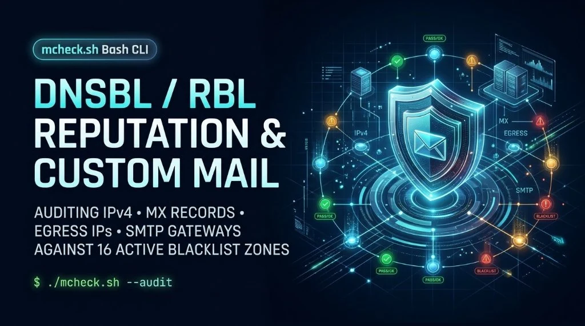

[🇺🇸 English](README.md) | 🇧🇷 **Português (BR)** | [🇪🇸 Español](README-es.md)

# mcheck — CLI de Monitoramento de DNSBL / RBL e Gateways SMTP Customizados

[](LICENSE)
[](https://github.com/sr00t3d/mcheck/releases)
[](https://www.gnu.org/software/bash/)
[](#requisitos)



O **`mcheck.sh`** é uma CLI leve em Bash para auditar endereços IPv4, domínios (registros A/MX), IP público de saída do servidor e **gateways de e-mail SMTP customizados (`customGateway`)** contra **16 zonas DNSBL / RBL ativas e verificadas empiricamente**.

Criado originalmente em 2014 por **Percio Andrade (Percio Castelo)** para monitorar gateways de e-mail em servidores compartilhados, a versão **`v2.0.0`** substitui os gateways fixos legados da HostGator por um gerenciador persistente de `customGateway`, remove blacklists extintas/obsoletas (SORBS, APEWS, Manitu, etc.), detecta bloqueios de resolvedores públicos do Spamhaus/CBL (`QUERY_BLOCKED`) e exporta relatórios estruturados em `table`, `json` e `csv` prontos para Cron, Zabbix e pipelines de NOC.

---

## Funcionalidades

- **16 DNSBLs Ativas e Verificadas (2026):** Lista curada de RBLs IPv4 funcionais (zonas mortas como SORBS e APEWS foram removidas).
- **Gerenciador de Gateways Customizados (`customGateway`):** Cadastre, liste, remova e audite em lote seus próprios relays SMTP em `~/.config/mcheck/gateways.conf` (ou arquivo próprio com `--gateways-file`).
- **Proteção contra Falsos Positivos (`QUERY_BLOCKED`):** Diferencia automaticamente códigos de bloqueio de resolvedor aberto do Spamhaus/CBL (`127.255.255.*`) de listagens reais (`LISTED`). Aceita `--resolver <ip>` para consultas via DNS recursivo dedicado/local.
- **Alvos Flexíveis:** Audite um IPv4 específico (`-i 1.1.1.1`), domínio com resolução automática de A/MX (`-i mail.exemplo.com.br`), o IP público de saída do host (`-m`) ou todos os gateways cadastrados (`-g`).
- **Pronto para Automação e NOC:** Suporte a `--only-listed`, `--exit-code` (retorna código `2` se houver qualquer IP `LISTED`) e `-o table|json|csv`.
- **Listas de RBL Personalizadas:** Sobrescreva as 16 zonas padrão a qualquer momento com `--rbl-file <caminho>`.

---

## DNSBLs Embutidas e Verificadas (16 Zonas)

| Categoria | Zonas DNSBL |
| :--- | :--- |
| **Reputação Principal** | `zen.spamhaus.org`, `cbl.abuseat.org`, `b.barracudacentral.org`, `bl.spamcop.net` |
| **Passivas / Política** | `psbl.surriel.com`, `ips.backscatterer.org`, `bl.mailspike.net`, `z.mailspike.net` |
| **UCEPROTECT** | `dnsbl-1.uceprotect.net`, `dnsbl-2.uceprotect.net`, `dnsbl-3.uceprotect.net` |
| **Abuso e Segurança** | `all.s5h.net`, `bl.0spam.org`, `rbl.interserver.net`, `bl.blocklist.de`, `bl.nordspam.com` |

> **Nota sobre Spamhaus e CBL (`QUERY_BLOCKED`):** Spamhaus e CBL retornam `127.255.255.254` quando consultados através de resolvedores públicos/abertos (como `8.8.8.8` ou `1.1.1.1`). O `mcheck.sh` classifica esses códigos como `QUERY_BLOCKED` em vez de disparar falsos alertas `LISTED`. Use `--resolver <seu-dns-local>` para consultá-los por um resolvedor não público.

---

## Requisitos

- Bash 4.0+
- `dig` (`bind-utils` / `dnsutils`)
- `curl` (necessário apenas para `-m` / `--my-ip`)
- Utilitários POSIX padrão (`awk`, `grep`, `sort`, `tr`)

---

## Instalação

```bash
git clone https://github.com/sr00t3d/mcheck.git
cd mcheck
chmod +x mcheck.sh

# Opcional: instalar globalmente
sudo install -m 0755 mcheck.sh /usr/local/bin/mcheck
```

---

## Como Usar

```bash
# Auditar um IPv4 específico ou domínio (resolve registros A/MX)
./mcheck.sh -i 1.1.1.1
./mcheck.sh -i cloudflare.com --only-listed

# Validar detecção com o IP de teste RFC 5782 (retorna exit code 2 se LISTED)
./mcheck.sh -i 127.0.0.2 --only-listed --exit-code

# Auditar o IP público de saída do servidor atual
./mcheck.sh -m
./mcheck.sh -m -o json

# Gerenciar e auditar gateways SMTP customizados (customGateway)
./mcheck.sh --add-gateway relay01.exemplo.com.br
./mcheck.sh --add-gateway 203.0.113.25
./mcheck.sh --list-gateways
./mcheck.sh -g --only-listed --exit-code
./mcheck.sh --remove-gateway 203.0.113.25

# Usar um arquivo de gateways personalizado e exportar em CSV
./mcheck.sh -g --gateways-file ./gateways.example.conf -o csv

# Usar um resolvedor DNS recursivo privado para Spamhaus/CBL
./mcheck.sh -i 203.0.113.10 --resolver 127.0.0.1
```

### Todas as Opções

| Opção | Descrição |
| :--- | :--- |
| `-i, --ip <ip\|domínio>` | Audita um IPv4 ou domínio (resolve registros A/MX) |
| `-m, --my-ip` | Audita o IPv4 público de saída do servidor atual |
| `-g, --check-gateways` | Audita todos os gateways customizados cadastrados |
| `--add-gateway <host\|ip>` | Cadastra um gateway SMTP em `gateways.conf` |
| `--remove-gateway <host\|ip>` | Remove um gateway SMTP de `gateways.conf` |
| `--list-gateways` | Lista todos os gateways customizados cadastrados |
| `--gateways-file <caminho>` | Arquivo de gateways customizados (padrão: `~/.config/mcheck/gateways.conf`) |
| `--rbl-file <caminho>` | Arquivo customizado de DNSBLs (uma zona por linha) |
| `--resolver <ip>` | IP de resolvedor DNS customizado |
| `--timeout <seg>` | Timeout por consulta DNSBL em segundos (padrão: `2`) |
| `--only-listed` | Exibe apenas linhas `LISTED` / `QUERY_BLOCKED` / `TIMEOUT` na tabela |
| `--exit-code` | Retorna código `2` se algum IP estiver `LISTED` (ideal para Cron/CI/NOC) |
| `-o, --output <fmt>` | Formato de saída: `table` (padrão), `json`, `csv` |
| `-q, --quiet` | Omite cabeçalho e resumo final |
| `--no-color` | Desativa cores ANSI |
| `-V, --version` | Exibe a versão e encerra |
| `-h, --help` | Exibe a ajuda e encerra |

---

## Exemplo Real de Saída

### Auditoria em Tabela (`./mcheck.sh -i 1.1.1.1`)

```text
================================================================================
 mcheck.sh v2.0.0 | DNSBL Reputation Audit (16 RBLs) | 2026-11-21T03:11:18Z
================================================================================
TARGET                 IP              DNSBL                      STATE          CODE
---------------------- --------------- -------------------------- -------------- ---------------
1.1.1.1                1.1.1.1         zen.spamhaus.org           QUERY_BLOCKED  127.255.255.254
1.1.1.1                1.1.1.1         cbl.abuseat.org            QUERY_BLOCKED  127.255.255.254
1.1.1.1                1.1.1.1         b.barracudacentral.org     CLEAN          -
1.1.1.1                1.1.1.1         bl.spamcop.net             CLEAN          -
1.1.1.1                1.1.1.1         psbl.surriel.com           CLEAN          -
1.1.1.1                1.1.1.1         dnsbl-1.uceprotect.net     CLEAN          -
1.1.1.1                1.1.1.1         dnsbl-2.uceprotect.net     CLEAN          -
1.1.1.1                1.1.1.1         dnsbl-3.uceprotect.net     CLEAN          -
1.1.1.1                1.1.1.1         bl.mailspike.net           CLEAN          -
1.1.1.1                1.1.1.1         z.mailspike.net            CLEAN          -
1.1.1.1                1.1.1.1         ips.backscatterer.org      CLEAN          -
1.1.1.1                1.1.1.1         all.s5h.net                CLEAN          -
1.1.1.1                1.1.1.1         bl.0spam.org               CLEAN          -
1.1.1.1                1.1.1.1         rbl.interserver.net        CLEAN          -
1.1.1.1                1.1.1.1         bl.blocklist.de            CLEAN          -
1.1.1.1                1.1.1.1         bl.nordspam.com            CLEAN          -

Summary: 16 checks | 14 CLEAN | 0 LISTED | 2 QUERY_BLOCKED | 0 TIMEOUT
```

### Teste de Detecção RFC 5782 (`./mcheck.sh -i 127.0.0.2 --only-listed --exit-code`)

```text
================================================================================
 mcheck.sh v2.0.0 | DNSBL Reputation Audit (16 RBLs) | 2026-11-21T03:11:20Z
================================================================================
TARGET                 IP              DNSBL                      STATE          CODE
---------------------- --------------- -------------------------- -------------- ---------------
127.0.0.2              127.0.0.2       zen.spamhaus.org           QUERY_BLOCKED  127.255.255.254
127.0.0.2              127.0.0.2       cbl.abuseat.org            QUERY_BLOCKED  127.255.255.254
127.0.0.2              127.0.0.2       b.barracudacentral.org     LISTED         127.0.0.2
127.0.0.2              127.0.0.2       bl.spamcop.net             LISTED         127.0.0.2
...
127.0.0.2              127.0.0.2       bl.nordspam.com            LISTED         127.0.0.2

Summary: 16 checks | 0 CLEAN | 14 LISTED | 2 QUERY_BLOCKED | 0 TIMEOUT
# Código de saída: 2
```

### Saída JSON (`./mcheck.sh -i 1.1.1.1 -o json`)

```json
{
  "tool": "mcheck.sh",
  "version": "2.0.0",
  "timestamp": "2026-11-21T03:11:22Z",
  "rbls_checked": 16,
  "total_checks": 16,
  "clean": 14,
  "listed": 0,
  "query_blocked": 2,
  "timeouts": 0,
  "results": [
    {
      "target": "1.1.1.1",
      "ip": "1.1.1.1",
      "rbl": "zen.spamhaus.org",
      "state": "QUERY_BLOCKED",
      "code": "127.255.255.254"
    },
    {
      "target": "1.1.1.1",
      "ip": "1.1.1.1",
      "rbl": "b.barracudacentral.org",
      "state": "CLEAN",
      "code": ""
    }
  ]
}
```

---

## Créditos e Histórico

- **Autor Original (2014):** Percio Andrade (Percio Castelo) — criado como monitor operacional de RBLs e gateways em servidores de e-mail compartilhados.
- **Modernização v2.0.0 (2026):** Percio Castelo — substituição dos gateways fixos da HostGator por `customGateway`, curadoria de 16 DNSBLs ativas em 2026, guarda `QUERY_BLOCKED` para Spamhaus/CBL e exportação JSON/CSV.

## Licença

Licenciado sob a [Apache License 2.0](LICENSE).
