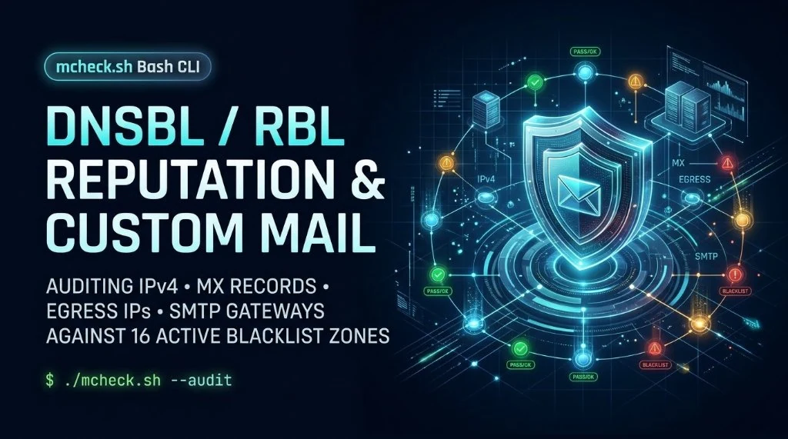

🇺🇸 **English** | [🇧🇷 Português (BR)](README-ptbr.md) | [🇪🇸 Español](README-es.md)

# mcheck — DNSBL / RBL Reputation & Custom Mail Gateway Monitor CLI

[](LICENSE)
[](https://github.com/sr00t3d/mcheck/releases)
[](mcheck.sh)
[](mcheck.ps1)



**`mcheck.sh`** is a lightweight Bash CLI for auditing IPv4 addresses, domains (A/MX records), local egress IPs, and **custom SMTP mail gateways (`customGateway`)** against **16 empirically verified active DNSBL / RBL zones**.

Originally created in 2014 by **Percio Andrade (Percio Castelo)** to monitor shared hosting mail gateways, **`v2.0.0`** replaces hardcoded legacy HostGator gateways with a persistent user-managed `customGateway` registry, removes dead/shutdown blacklists (SORBS, APEWS, Manitu, etc.), adds Spamhaus/CBL public-resolver detection (`QUERY_BLOCKED`), and outputs structured `table`, `json`, and `csv` reports ready for Cron, Zabbix, and NOC pipelines.

---

## Features

- **16 Verified Active DNSBLs (2026):** Curated list of live IPv4 RBLs (dead zones like SORBS and APEWS removed).
- **Custom Mail Gateway Manager (`customGateway`):** Register, list, remove, and batch-audit your own SMTP relays in `~/.config/mcheck/gateways.conf` (or a custom file via `--gateways-file`).
- **False-Positive Guard (`QUERY_BLOCKED`):** Automatically distinguishes Spamhaus/CBL open-resolver blocks (`127.255.255.*`) from actual blacklist listings (`LISTED`). Supports `--resolver <ip>` for dedicated/local recursive resolvers.
- **Flexible Targets:** Audit a single IPv4 (`-i 1.1.1.1`), domain with automatic A/MX resolution (`-i mail.example.com`), your host's public egress IP (`-m`), or all registered custom gateways (`-g`).
- **Automation & CI/NOC Ready:** Supports `--only-listed`, `--exit-code` (exits `2` if any IP is `LISTED`), and `-o table|json|csv`.
- **Custom RBL Lists:** Override the built-in 16 zones anytime with `--rbl-file <path>`.

---

## Built-in Verified DNSBLs (16 Zones)

| Category | DNSBL Zones |
| :--- | :--- |
| **Major Reputation** | `zen.spamhaus.org`, `cbl.abuseat.org`, `b.barracudacentral.org`, `bl.spamcop.net` |
| **Passive / Policy** | `psbl.surriel.com`, `ips.backscatterer.org`, `bl.mailspike.net`, `z.mailspike.net` |
| **UCEPROTECT** | `dnsbl-1.uceprotect.net`, `dnsbl-2.uceprotect.net`, `dnsbl-3.uceprotect.net` |
| **Abuse & Security** | `all.s5h.net`, `bl.0spam.org`, `rbl.interserver.net`, `bl.blocklist.de`, `bl.nordspam.com` |

> **Note on Spamhaus & CBL (`QUERY_BLOCKED`):** Spamhaus and CBL return `127.255.255.254` when queried through public/open resolvers (such as `8.8.8.8` or `1.1.1.1`). `mcheck.sh` classifies these codes as `QUERY_BLOCKED` rather than false `LISTED` alerts. Pass `--resolver <your-local-dns>` to query them via a non-public resolver.

---

## Requirements

- Bash 4.0+
- `dig` (`bind-utils` / `dnsutils`)
- `curl` (only required for `-m` / `--my-ip`)
- Standard POSIX utilities (`awk`, `grep`, `sort`, `tr`)

---

## Installation

```bash
git clone https://github.com/sr00t3d/mcheck.git
cd mcheck
chmod +x mcheck.sh

# Optional: install globally
sudo install -m 0755 mcheck.sh /usr/local/bin/mcheck
```

---

## Usage

```bash
# Check a specific IPv4 or domain (resolves A/MX records)
./mcheck.sh -i 1.1.1.1
./mcheck.sh -i cloudflare.com --only-listed

# Verify detection with RFC 5782 test IP (exits 2 when LISTED)
./mcheck.sh -i 127.0.0.2 --only-listed --exit-code

# Check your current server's public egress IP
./mcheck.sh -m
./mcheck.sh -m -o json

# Manage and audit custom SMTP mail gateways (customGateway)
./mcheck.sh --add-gateway relay01.example.com
./mcheck.sh --add-gateway 203.0.113.25
./mcheck.sh --list-gateways
./mcheck.sh -g --only-listed --exit-code
./mcheck.sh --remove-gateway 203.0.113.25

# Use a custom gateways file and export to CSV
./mcheck.sh -g --gateways-file ./gateways.example.conf -o csv

# Use a private recursive DNS resolver for Spamhaus/CBL
./mcheck.sh -i 203.0.113.10 --resolver 127.0.0.1
```

### Windows (PowerShell `mcheck.ps1`)

Zero external dependencies — works natively on **Windows PowerShell 5.1** and **PowerShell 7+** (`Resolve-DnsName` / `.NET DNS`):

```powershell
# Check an IPv4 or domain (resolves A/MX records)
.\mcheck.ps1 -Ip 1.1.1.1
.\mcheck.ps1 -Ip 127.0.0.2 -OnlyListed -ExitCode

# Check your current public egress IP in JSON
.\mcheck.ps1 -MyIp -Output json

# Manage and audit custom SMTP gateways (%AppData%\mcheck\gateways.conf)
.\mcheck.ps1 -AddGateway relay01.example.com
.\mcheck.ps1 -ListGateways
.\mcheck.ps1 -CheckGateways -OnlyListed -ExitCode
.\mcheck.ps1 -RemoveGateway relay01.example.com
```

### All Options

| Option | Description |
| :--- | :--- |
| `-i, --ip <ip\|domain>` | Check an IPv4 address or domain (resolves A/MX records) |
| `-m, --my-ip` | Check the current host's public egress IPv4 |
| `-g, --check-gateways` | Audit all registered custom gateways |
| `--add-gateway <host\|ip>` | Register a custom SMTP gateway in `gateways.conf` |
| `--remove-gateway <host\|ip>` | Remove a custom SMTP gateway from `gateways.conf` |
| `--list-gateways` | List all registered custom gateways |
| `--gateways-file <path>` | Custom gateways file (default: `~/.config/mcheck/gateways.conf`) |
| `--rbl-file <path>` | Custom DNSBL zone file (one zone per line) |
| `--resolver <ip>` | Custom DNS resolver IP |
| `--timeout <sec>` | DNS query timeout per RBL in seconds (default: `2`) |
| `--only-listed` | Show only `LISTED` / `QUERY_BLOCKED` / `TIMEOUT` rows in table output |
| `--exit-code` | Exit with code `2` if any IP is `LISTED` (for Cron/CI/NOC) |
| `-o, --output <fmt>` | Output format: `table` (default), `json`, `csv` |
| `-q, --quiet` | Suppress banner header and summary footer |
| `--no-color` | Disable ANSI colors |
| `-V, --version` | Show version and exit |
| `-h, --help` | Show help and exit |

---

## Real Output Example

### Table Audit (`./mcheck.sh -i 1.1.1.1`)

```text
================================================================================
 mcheck.sh v2.0.0 | DNSBL Reputation Audit (16 RBLs) | 2026-11-21T03:11:18Z
================================================================================
TARGET                 IP              DNSBL                      STATE          CODE
---------------------- --------------- -------------------------- -------------- ---------------
1.1.1.1                1.1.1.1         zen.spamhaus.org           QUERY_BLOCKED  127.255.255.254
1.1.1.1                1.1.1.1         cbl.abuseat.org            QUERY_BLOCKED  127.255.255.254
1.1.1.1                1.1.1.1         b.barracudacentral.org     CLEAN          -
1.1.1.1                1.1.1.1         bl.spamcop.net             CLEAN          -
1.1.1.1                1.1.1.1         psbl.surriel.com           CLEAN          -
1.1.1.1                1.1.1.1         dnsbl-1.uceprotect.net     CLEAN          -
1.1.1.1                1.1.1.1         dnsbl-2.uceprotect.net     CLEAN          -
1.1.1.1                1.1.1.1         dnsbl-3.uceprotect.net     CLEAN          -
1.1.1.1                1.1.1.1         bl.mailspike.net           CLEAN          -
1.1.1.1                1.1.1.1         z.mailspike.net            CLEAN          -
1.1.1.1                1.1.1.1         ips.backscatterer.org      CLEAN          -
1.1.1.1                1.1.1.1         all.s5h.net                CLEAN          -
1.1.1.1                1.1.1.1         bl.0spam.org               CLEAN          -
1.1.1.1                1.1.1.1         rbl.interserver.net        CLEAN          -
1.1.1.1                1.1.1.1         bl.blocklist.de            CLEAN          -
1.1.1.1                1.1.1.1         bl.nordspam.com            CLEAN          -

Summary: 16 checks | 14 CLEAN | 0 LISTED | 2 QUERY_BLOCKED | 0 TIMEOUT
```

### RFC 5782 Detection Test (`./mcheck.sh -i 127.0.0.2 --only-listed --exit-code`)

```text
================================================================================
 mcheck.sh v2.0.0 | DNSBL Reputation Audit (16 RBLs) | 2026-11-21T03:11:20Z
================================================================================
TARGET                 IP              DNSBL                      STATE          CODE
---------------------- --------------- -------------------------- -------------- ---------------
127.0.0.2              127.0.0.2       zen.spamhaus.org           QUERY_BLOCKED  127.255.255.254
127.0.0.2              127.0.0.2       cbl.abuseat.org            QUERY_BLOCKED  127.255.255.254
127.0.0.2              127.0.0.2       b.barracudacentral.org     LISTED         127.0.0.2
127.0.0.2              127.0.0.2       bl.spamcop.net             LISTED         127.0.0.2
...
127.0.0.2              127.0.0.2       bl.nordspam.com            LISTED         127.0.0.2

Summary: 16 checks | 0 CLEAN | 14 LISTED | 2 QUERY_BLOCKED | 0 TIMEOUT
# Exit code: 2
```

### JSON Output (`./mcheck.sh -i 1.1.1.1 -o json`)

```json
{
  "tool": "mcheck.sh",
  "version": "2.0.0",
  "timestamp": "2026-11-21T03:11:22Z",
  "rbls_checked": 16,
  "total_checks": 16,
  "clean": 14,
  "listed": 0,
  "query_blocked": 2,
  "timeouts": 0,
  "results": [
    {
      "target": "1.1.1.1",
      "ip": "1.1.1.1",
      "rbl": "zen.spamhaus.org",
      "state": "QUERY_BLOCKED",
      "code": "127.255.255.254"
    },
    {
      "target": "1.1.1.1",
      "ip": "1.1.1.1",
      "rbl": "b.barracudacentral.org",
      "state": "CLEAN",
      "code": ""
    }
  ]
}
```

---

## Credits & History

- **Original Author (2014):** Percio Andrade (Percio Castelo) — created as an operational RBL/gateway reputation monitor for shared mail servers.
- **v2.0.0 Modernization (2026):** Percio Castelo — replaced hardcoded HostGator gateways with `customGateway`, curated 16 active 2026 DNSBLs, added Spamhaus/CBL `QUERY_BLOCKED` guard and JSON/CSV export.

## License

Licensed under the [Apache License 2.0](LICENSE).
